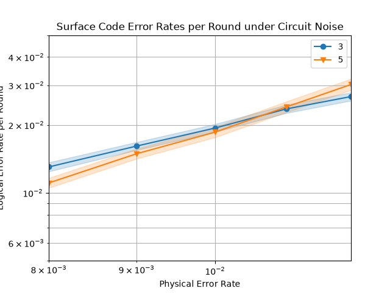

# Neural decoder for the surface code

This project aims to examine if a neural network can decode the surface code about as well as PyMatching, and how fast it can run if I rewrite the inference in C.

## Status

| Phase | What | Status |
|---|---|---|
| 1 | Circuits with Stim, dataset, PyMatching baseline, threshold plot | Done |
| 2 | Neural decoders in PyTorch (first an MLP, then a small transformer) | In progress |
| 3 | Inference engine in C, checked against PyTorch, latency comparison | Planned |

## The task

I simulate a surface code memory experiment. The logical qubit starts in |0⟩, the stabilizers are measured for a few rounds with noise, and at the end the data qubits are measured.

- Input: the detection events of one shot. Each detector is 1 if its stabilizer changed compared to the previous round, and 0 if not.
- Label: 1 if the logical value was flipped at the end, 0 if not.
- The decoder gets the detection events and predicts the label. The logical error rate is how often it gets it wrong.

With distance 3 and 3 rounds there are 24 detectors per shot.

## Phase 1

- `make_circuit(p, d, r)` builds a rotated surface code circuit (memory in the Z basis) with noise `p` after gates, after resets, before measurements and on the data qubits each round.
- `make_dataset(circuit, shots, path)` samples the detection events and the labels with a fixed seed and saves them in a compressed NumPy file. The data files are not in the repo, you can regenerate them with this function.
- `pymatching_errors(circuit, dets, obs)` runs PyMatching on a saved test set. The neural networks will be tested on the same set.

### Threshold plot



The d = 3 and d = 5 curves cross around p = 1 %, which is the expected threshold for this noise. Below that, the bigger code gives fewer logical errors.

## How to run it

```bash
pip install stim pymatching sinter numpy matplotlib
```

Then run proyect.py.

## Baseline: Config: p = 0.009, d = 3, r = 3, test shots = 1,000,000
Detectors per shot: 24
Fraction of flips in test: 0.1717
PyMatching logical error rate: 4.9502% ± 0.0217%
PyMatching time per shot: 0.74 µs

## Next steps

1. Train an MLP on the d = 3, 3-round data and compare it with PyMatching and with always predicting "no flip".
2. Train a small transformer where each token is a detection event with its position in space and time.
3. Export the weights, write the inference in C, check that it gives the same output as PyTorch, and compare its speed with PyMatching.

## Limitations

- The data is simulated with a simple noise model. Real hardware has correlated errors, leakage and drift.
- Only small distances.
- Phase 1 follows the Stim "Getting Started" tutorial. My own work is mainly the dataset pipeline and phases 2 and 3.

## References

- C. Gidney, Stim: a fast stabilizer circuit simulator, Quantum 5, 497 (2021), and the Stim "Getting Started" tutorial.
- O. Higgott and C. Gidney, Sparse Blossom: correcting a million errors per core second with minimum-weight matching (PyMatching 2).
- G. Torlai and R. G. Melko, Neural decoder for topological codes, Phys. Rev. Lett. 119, 030501 (2017).
- J. Bausch et al., Learning high-accuracy error decoding for quantum processors, Nature (2024).
- J. Roffe, Quantum Error Correction: An Introductory Guide, arXiv:1907.11157.